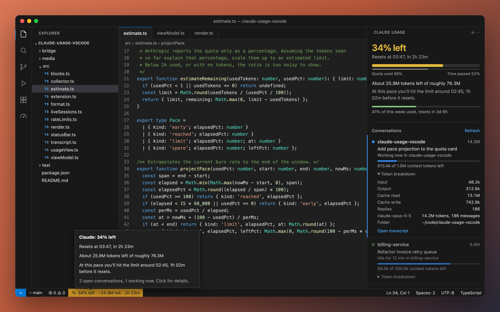

# Claude Usage Monitor

A local-only VS Code extension that shows Claude Code usage per conversation window and the subscription's 5-hour quota.



- **Status bar:** `34% left · ~25.9M tok · 2h 23m`: share of the 5-hour quota left, estimated tokens left, time to reset. It turns yellow at `claudeUsage.warnAt` (80%), and also earlier if your current pace would hit the limit before the reset. It turns red at 95%.
- **Sidebar (gauge icon):** in both the left activity bar and the right secondary side bar (open it with ⌥⌘B). The status bar item and **Claude Usage: Show Usage** open the right-hand one.
  - **Quota.** The headline is what's left. Below it are two bars: quota used, and time passed in the 5-hour window. If the quota bar is ahead of the time bar, you're spending faster than the window refills.
    - "About 25.9M tokens left of roughly 76.3M" is estimated from the tokens this Mac used inside the official window.
    - A pace sentence follows, e.g. "At this pace you'll hit the limit around 03:47" or "…finish with about 30% to spare".
    - The weekly bar sits underneath.
  - **Conversations.** One entry per Claude Code window: working (pulsing blue), idle, or closed. Each shows its tokens and context tokens left (e.g. "813.4k of 1.0M"). A collapsible token breakdown lists input / output / cache / replies / per model, plus *Open transcript*.

The tokens-left number assumes your recent mix of input, output and cache tokens stays the same. The quota also counts usage outside this Mac (claude.ai, other machines), so treat the token figure as a guide. The percentage is the official number.

## Where the numbers come from

Everything is read from `~/.claude`. There are no network calls and no credentials are read.

| Data | Source |
|---|---|
| Open windows | `~/.claude/sessions/<pid>.json` (dead pids ignored) |
| Tokens per conversation | `~/.claude/projects/*/<session>.jsonl` + `<session>/subagents/*.jsonl`, deduplicated by message id |
| 5h / 7d quota, context tokens | Claude Code only gives these to its **status line command**. `bridge/statusline-bridge.js` saves them to `~/.claude/usage-monitor/sessions/<session>.json` |

Run **Claude Usage: Install Status Line Bridge** once. It copies the bridge to `~/.claude/usage-monitor/`, backs up `settings.json` to `settings.json.bak-claude-usage`, and sets `statusLine` to an absolute node path. Version-manager shims fail in folders with no version set, which is why it uses an absolute path. It never replaces an existing status line. The quota appears after the next Claude response.

The local 5h window is an estimate in the style of ccusage: it starts at your first message, rounded down to the hour, and lasts 5 h. It counts tokens, not the official percentage.

## Develop

```bash
npm install
npm test            # vitest, pure modules + fixture ~/.claude
npm run typecheck
npm run package     # -> claude-usage-monitor-<version>.vsix
code --install-extension claude-usage-monitor-0.1.0.vsix
```

Settings: `claudeUsage.refreshSeconds` (10), `claudeUsage.scope` (`workspace` | `all`), `claudeUsage.warnAt` (80).
